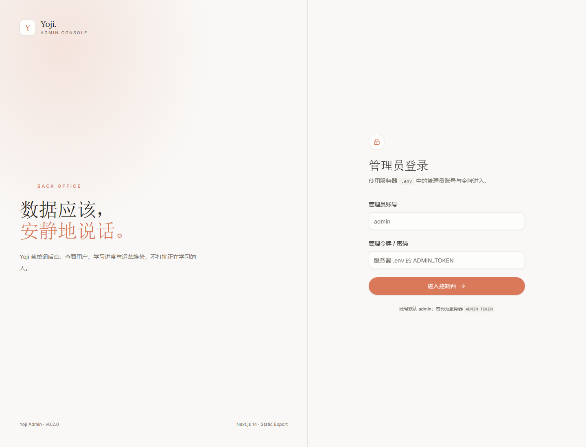
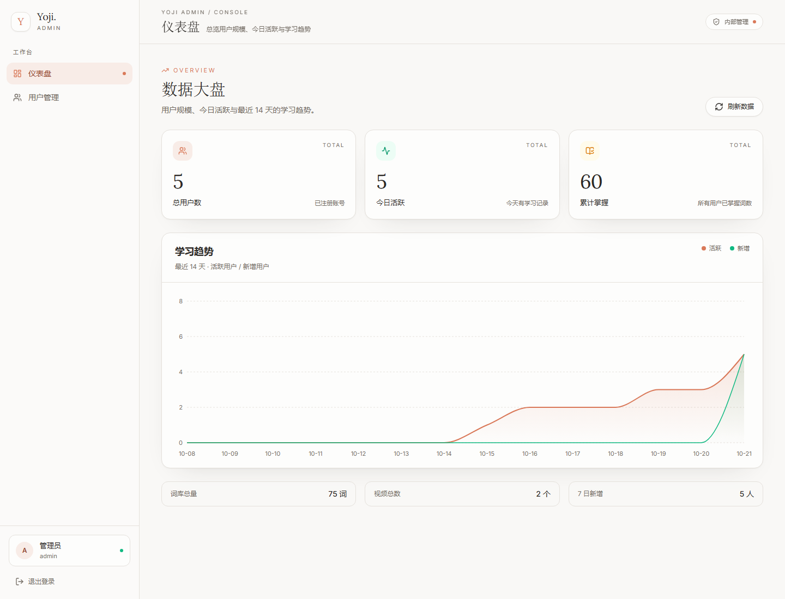
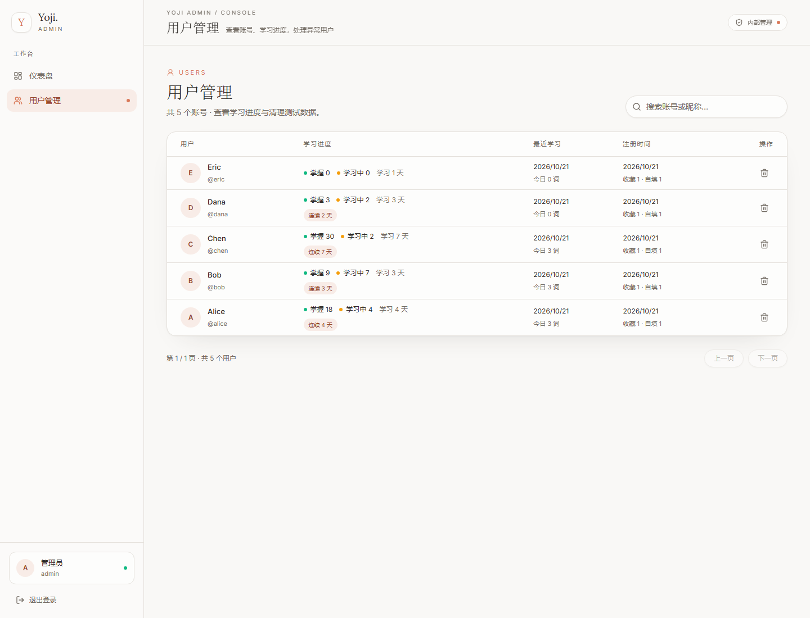

# Yoji Admin

Yoji 背单词项目的后台管理系统。**阶段一 ~ 阶段六已完成**：静态导出、Axios + SWR、管理员登录、路由守卫、Sidebar/Header、数据大盘、用户管理（搜索/分页/删除）。

> 线上地址：<https://yoji.zhdstudy.cyou/>（2026-10-22 已部署）
> 管理员账号 `admin`，密码在服务器 `/www/wwwroot/yoji/server/.env` 的 `ADMIN_TOKEN`。

> 前端是纯静态导出，不跑 Next.js 服务端，也不在 Next.js 里连数据库。
> 所有数据都通过 Node API（`/api/admin/*`）获取。

## 技术栈

- Next.js 14（App Router，`output: "export"`）
- TypeScript + Tailwind CSS 3
- Shadcn UI（classic `new-york` registry）+ Lucide
- Axios（Token 拦截器 / 401 跳转）+ SWR（缓存 / 刷新）
- Recharts（14 天趋势面积图）
- 字体 Lora + Inter（`@fontsource-variable` 构建时自托管）

## 快速开始

```bash
cd yoji-admin
npm install
npm run dev      # 开发：http://localhost:3000
npm run build    # 静态导出到 yoji-admin/out/
npm start        # 预览 out/：http://localhost:4173
```

### API 地址

通过 `NEXT_PUBLIC_API_ORIGIN` 控制（静态导出会在 build 时写死）：

| 场景 | 值 | 请求地址 |
| --- | --- | --- |
| 本地开发（默认 `.env.development`） | `http://120.24.171.99` | `http://120.24.171.99/api/admin/...` |
| 线上静态部署（`.env.production`） | 空 | 同源 `/api/admin/...`，由 Nginx 反代 |

线上不要从 HTTPS 页面直接请求 `http://120.24.171.99`，会被浏览器 Mixed Content 拦截。Nginx 配置见 [../docs/deploy-admin-baota.md](../docs/deploy-admin-baota.md)。

### 管理员登录

- 超级管理员：`admin` / 服务器 `.env` 的 `ADMIN_TOKEN`
- 测试管理员：`hans` / `123456`、`zhd` / `123456`（全部权限）
- 登录接口：`POST /api/admin/login`，返回 `role=admin` 的 JWT
- 前端把 token 存在 `localStorage` 的 `yoji_admin_token`，请求时自动加 `Authorization: Bearer ...`
- 401 会自动清 token 并跳 `/login`

后端需要先部署包含 `server/src/routes/adminPanel.js` 的版本，否则登录会 404。

## 页面

| 路由 | 说明 |
| --- | --- |
| `/` | 按登录态跳 `/dashboard` 或 `/login` |
| `/login` | 管理员登录，Claude 双栏布局 |
| `/dashboard` | 3 张指标卡 + Recharts 14 天趋势图 + 附加统计 |
| `/users` | 用户表格、搜索、分页、删除确认 |
| `/videos` | 视频列表、浏览器上传视频/封面、编辑、显示/隐藏、删除 |







## 目录结构

```
yoji-admin/
├─ app/
│  ├─ (admin)/
│  │  ├─ layout.tsx       # 路由组布局 + 客户端守卫
│  │  ├─ dashboard/       # 数据大盘
│  │  └─ users/           # 用户管理
│  ├─ login/              # 管理员登录
│  ├─ globals.css         # Claude 色板 / 字体变量
│  ├─ layout.tsx          # 根布局、字体、metadata
│  └─ page.tsx            # 欢迎页 / 设计预览
├─ components/
│  ├─ AdminShell.tsx      # 登录守卫 + 侧栏/顶栏骨架
│  ├─ Header.tsx
│  ├─ Sidebar.tsx
│  └─ ui/                 # Shadcn 组件
├─ lib/
│  ├─ axios.ts            # baseURL / Token / 401
│  ├─ fetcher.ts          # SWR fetcher
│  ├─ types.ts
│  ├─ format.ts
│  └─ use-debounced-value.ts
├─ .env.development       # 本地直连 120.24.171.99
├─ .env.production        # 线上同源 /api
└─ out/                   # 构建产物
```

## 后端接口依赖

| 方法 | 路径 | 说明 |
| --- | --- | --- |
| POST | `/api/admin/login` | `{ account, password }` → `{ token, account, expiresIn }` |
| GET | `/api/admin/stats` | `totalUsers/todayActive/masteredWords/trend` |
| GET | `/api/admin/users` | `?search=&page=&pageSize=` |
| DELETE | `/api/admin/users/:id` | 删除用户及进度 |
| GET | `/api/admin/videos` | 视频列表（含隐藏） |
| POST | `/api/admin/videos/upload` | multipart：video + cover + 标题/日期/排序 |
| PATCH | `/api/admin/videos/:id` | 修改标题/日期/排序/显示状态 |
| DELETE | `/api/admin/videos/:id` | 删除视频记录 |

详细字段见 [server/README.md](../server/README.md) 的「后台管理」。

## 设计令牌

| Token | 值 |
| --- | --- |
| Paper | `#F9F8F6` |
| Ink | `#2D2A26` |
| Terracotta | `#D97757` |
| Border | `#E7E3DC` |
| Radius | `0.75rem` |
| Heading | Lora |
| Body | Inter |

## 部署

静态文件上传到 `/www/wwwroot/yoji-admin`，Nginx 根目录指向它，并把 `/api/` 反代到 `http://127.0.0.1:3000`。完整步骤（含宝塔操作）见 [../docs/deploy-admin-baota.md](../docs/deploy-admin-baota.md)。

## 已知限制

- 删除用户不可恢复；当前没有软删除/回收站。
- 统计按中国时区（UTC+8）计算「今天」。
- 管理后台 JWT 有效期默认 12 小时，没有刷新 token；过期后重新登录。
- 域名 `yoji.zhdstudy.cyou` 未备案，大陆阿里云可能拦截 80/443。
